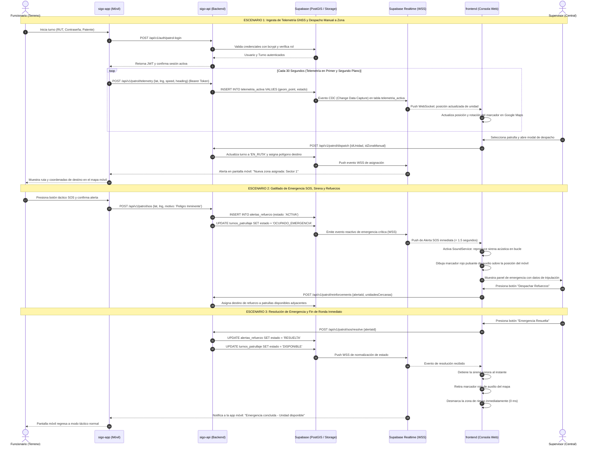

# DIAGRAMAS DE DISEÑO Y EVOLUCIÓN — ITERACIÓN 2 (SPRINT 2)
## S.I.G.O. — Sistema Inteligente de Gestión Operativa
### Arquitectura Avanzada, Flujos de Lazo Cerrado y Comparativa de Evolución (Sprint 1 vs. Sprint 2)

---

| **Ficha Técnica** | **Detalle** |
|---|---|
| **Proyecto** | Sistema Inteligente de Gestión Operativa (S.I.G.O.) |
| **Iteración** | Sprint 2 (Patrullaje Reactivo, Telemetría GNSS, SOS y Supervisión Táctica) |
| **Componentes Activos** | `sigo-app` (Móvil), `sigo-api` (Backend Node.js), `frontend` (Consola Web Angular 18), `Supabase` (PostGIS / Storage / Realtime) |
| **Propósito del Documento** | Proveer el código formal de los diagramas arquitectónicos y de comportamiento de la Iteración 2, junto con la fundamentación analítica de la evolución del producto según la comparativa visual del Sprint 1 vs. Sprint 2. |

---

# ÍNDICE

1. [Diagrama de Componentes (Iteración 2)](#1-diagrama-de-componentes-iteración-2)
2. [Diagrama de Flujo del Lazo Cerrado Operativo (Iteración 2)](#2-diagrama-de-flujo-del-lazo-cerrado-operativo-iteración-2)
3. [Diagrama de Secuencia (Iteración 2)](#3-diagrama-de-secuencia-iteración-2)
4. [Explicación de la Evolución: Sprint 1 vs. Sprint 2](#4-explicación-de-la-evolución-sprint-1-vs-sprint-2)
5. [Definición del Producto Mínimo Viable (MVP) — Iteración 2](#5-definición-del-producto-mínimo-viable-mvp--iteración-2)

---

## 1. Diagrama de Componentes (Iteración 2)

```mermaid
graph TB
    subgraph TIER_MOBILE["«device» Cliente Móvil Terreno (sigo-app - React Native / Expo)"]
        subgraph MOD_AUTH_MOB["Módulo de Acceso & Sesión"]
            COMP_LOGIN_MOB["LoginScreen & AuthContext"]
            COMP_SECURE["expo-secure-store (JWT Storage)"]
            COMP_CREW["PatrolCrewList (Dotación)"]
        end

        subgraph MOD_TELEMETRY["Módulo de Telemetría GNSS"]
            COMP_GNSS["gnss.service (expo-location)"]
            COMP_BG["Background Location Task"]
            COMP_GNSS_PANEL["GnssStatusPanel"]
        end

        subgraph MOD_OPERATIONAL["Módulo Táctico & Emergencias"]
            COMP_SOS["TacticalButton (SOS Pánico)"]
            COMP_MODAL_SOS["EmergencyConfirmModal"]
            COMP_EVIDENCE["evidence.service (Cámara/Storage)"]
            COMP_CHAT_MOB["MessagesScreen & audioService"]
        end
    end

    subgraph TIER_BACKEND["«server» Servidor API REST & Orquestador (sigo-api - Node.js / Express)"]
        subgraph ROUTERS["Capa de Rutas & Middleware"]
            ROUT_AUTH["auth.routes (/api/v1/auth)"]
            ROUT_PATROL["patrol.routes (/api/v1/patrol)"]
            ROUT_EVID["evidence.routes (/api/v1/evidence)"]
            ROUT_SES["sesiones.routes (/api/v1/sesiones)"]
            MID_AUTH["authenticateToken (JWT Verify)"]
            MID_UPLOAD["Multer Middleware (Binary Ingest)"]
        end

        subgraph CONTROLLERS["Capa de Lógica de Negocio"]
            CTRL_AUTH["auth.controller & jwt.utils"]
            CTRL_PATROL["patrol.controller (SOS & Telemetry)"]
            CTRL_MISSION["mission.controller (Despacho / Arribo)"]
            CTRL_EVID["evidence.controller"]
            CTRL_SES["sesiones.controller"]
            SWEEPER["sessionSweeper (Cierre Inactividad 15m)"]
        end
    end

    subgraph TIER_WEB["«device» Consola Web Supervisor (frontend - Angular 18 Standalone)"]
        subgraph WEB_PRESENTATION["Vistas & Componentes Tácticos"]
            COMP_MAP_WEB["DashboardComponent & MapService"]
            COMP_DISPATCH["DispatchModalComponent (Despacho Manual)"]
            COMP_EVID_WEB["EvidenceComponent (Visor Multimedia)"]
            COMP_MSG_WEB["MessagesComponent (Chat & Audio Player)"]
            COMP_USERS["UsersComponent (Gestión RBAC)"]
            COMP_ZONES["ZonesComponent (Ajustes de Rotación)"]
        end

        subgraph WEB_CORE["Estado Reactivo & Servicios"]
            STORE_WEB["DashboardStore (Angular Signals)"]
            SVC_SOUND["SoundService (Sirena SOS & Chimes)"]
            SVC_SUPA_WEB["SupabaseService (Realtime Client)"]
            SVC_AUTH_WEB["AuthService & AuthGuard"]
        end
    end

    subgraph TIER_BAAS["«cloud infrastructure» Plataforma Supabase (AWS us-east-1)"]
        subgraph POSTGRES["Base de Datos PostgreSQL 15 + PostGIS 3.3"]
            TAB_USERS["usuarios (RBAC)"]
            TAB_TURNOS["turnos_patrullaje & vehiculos"]
            TAB_CREW["dotacion_turno"]
            TAB_TELEM["telemetria_activa (Point 4326 GiST)"]
            TAB_ZONAS["zonas_patrullaje (Polygon 4326 GiST)"]
            TAB_ALERT["alertas_refuerzo (SOS)"]
            TAB_MSG["mensajes (Texto & Audio URL)"]
            RLS_POL["Políticas RLS (Row Level Security)"]
        end

        subgraph STORAGE["Supabase Storage"]
            BUCKET_EVID["Bucket evidencias_procedimientos"]
            BUCKET_AUDIO["Bucket notas_de_voz"]
        end

        subgraph REALTIME["Supabase Realtime Engine"]
            WSS_SERVER["WebSocket Server (WSS CDC Events)"]
        end
    end

    %% Relaciones Móvil -> API
    COMP_LOGIN_MOB -->|"POST /verify-credentials<br>POST /patrol-login"| ROUT_AUTH
    COMP_GNSS -->|"POST /telemetry (JSON)"| ROUT_PATROL
    COMP_SOS -->|"POST /sos (Alerta Inmediata)"| ROUT_PATROL
    COMP_EVIDENCE -->|"POST /evidence/upload (Multipart)"| ROUT_EVID
    COMP_CHAT_MOB -->|"POST /message & /message/audio"| ROUT_PATROL

    %% Relaciones internas API
    ROUT_AUTH --> MID_AUTH --> CTRL_AUTH
    ROUT_PATROL --> MID_AUTH --> CTRL_PATROL
    ROUT_PATROL --> CTRL_MISSION
    ROUT_EVID --> MID_UPLOAD --> CTRL_EVID
    ROUT_SES --> CTRL_SES
    SWEEPER -->|"Cierra sesiones > 15m sin GPS"| TAB_TURNOS

    %% Relaciones API -> Base de Datos
    CTRL_AUTH --> TAB_USERS
    CTRL_AUTH --> TAB_TURNOS
    CTRL_PATROL --> TAB_TELEM
    CTRL_PATROL --> TAB_ALERT
    CTRL_EVID --> BUCKET_EVID
    CTRL_EVID --> TAB_EVIDENCES["evidencias"]
    CTRL_PATROL --> BUCKET_AUDIO
    CTRL_PATROL --> TAB_MSG

    %% Relaciones Web -> API / Supabase
    SVC_AUTH_WEB -->|"POST /auth/login (JWT)"| ROUT_AUTH
    COMP_DISPATCH -->|"POST /patrol/dispatch (Manual)"| ROUT_PATROL
    COMP_MAP_WEB --> STORE_WEB
    STORE_WEB --> SVC_SOUND
    SVC_SUPA_WEB -->|"WSS Suscripción Realtime<br>(INSERT/UPDATE telemetria, alertas, msgs)"| WSS_SERVER
    WSS_SERVER -->|"Stream de Eventos Reactivos"| SVC_SUPA_WEB
    SVC_SUPA_WEB -->|"Actualiza Signals"| STORE_WEB

    classDef mobileStyle fill:#0f172a,stroke:#38bdf8,stroke-width:1.5px,color:#f8fafc;
    classDef apiStyle fill:#064e3b,stroke:#34d399,stroke-width:1.5px,color:#f8fafc;
    classDef webStyle fill:#1e1b4b,stroke:#818cf8,stroke-width:1.5px,color:#f8fafc;
    classDef baasStyle fill:#312e81,stroke:#c084fc,stroke-width:1.5px,color:#f8fafc;

    class COMP_LOGIN_MOB,COMP_SECURE,COMP_CREW,COMP_GNSS,COMP_BG,COMP_GNSS_PANEL,COMP_SOS,COMP_MODAL_SOS,COMP_EVIDENCE,COMP_CHAT_MOB mobileStyle;
    class ROUT_AUTH,ROUT_PATROL,ROUT_EVID,ROUT_SES,MID_AUTH,MID_UPLOAD,CTRL_AUTH,CTRL_PATROL,CTRL_MISSION,CTRL_EVID,CTRL_SES,SWEEPER apiStyle;
    class COMP_MAP_WEB,COMP_DISPATCH,COMP_EVID_WEB,COMP_MSG_WEB,COMP_USERS,COMP_ZONES,STORE_WEB,SVC_SOUND,SVC_SUPA_WEB,SVC_AUTH_WEB webStyle;
    class TAB_USERS,TAB_TURNOS,TAB_CREW,TAB_TELEM,TAB_ZONAS,TAB_ALERT,TAB_MSG,RLS_POL,BUCKET_EVID,BUCKET_AUDIO,WSS_SERVER baasStyle;
```



---

## 2. Diagrama de Flujo del Lazo Cerrado Operativo (Iteración 2)

```mermaid
flowchart TD
    Start(["Inicio de Turno Operativo en Terreno"]) --> LoginMobile["Funcionario inicia sesión en sigo-app (RUT y Clave)<br>Selecciona Vehículo (Patrulla/Moto/Bici) y agrega acompañantes"]
    LoginMobile --> AuthCheck{"¿Credenciales y<br>Rol Válidos?"}
    
    AuthCheck -- NO --> DenyLogin["Rechazar acceso.<br>Mostrar error en pantalla móvil."] --> LoginMobile
    AuthCheck -- SÍ --> SessionActive["Generar Token JWT y registrar turno en base de datos.<br>Estado de unidad: DISPONIBLE."]
    
    SessionActive --> GPSStart["Activar telemetría continua (primer y segundo plano).<br>Transmisión de coordenadas GPS a la API cada 30 segundos."]
    
    GPSStart --> WebSync["Servidor ingesta coordenadas en PostGIS.<br>Supabase Realtime actualiza posición del móvil en el mapa del Supervisor."]
    
    WebSync --> DispatchDecision{"¿Modalidad de<br>Asignación de Zona?"}
    
    %% Rama Despacho Manual
    DispatchDecision -- "Despacho Manual (Supervisor)" --> ManualSelect["Supervisor selecciona móvil disponible y elige cuadrante en el mapa"]
    ManualSelect --> ManualDispatch["Enviar orden de despacho manual.<br>Zona queda marcada y excluida de la rotación automática."]
    
    %% Rama Despacho Automático
    DispatchDecision -- "Despacho Automático (Algoritmo)" --> AutoAlgorithm["Temporizador de rotación de zonas (cada 30-300s)<br>Algoritmo asigna patrullas libres a sectores calientes no cubiertos"]
    
    ManualDispatch --> TransitionEnRuta["Unidad cambia a estado EN_RUTA.<br>Notificación táctica recibida en el smartphone del funcionario."]
    AutoAlgorithm --> TransitionEnRuta
    
    TransitionEnRuta --> CheckDeviation{"¿Unidad excede el ETA<br>o abandona la ruta?"}
    CheckDeviation -- SÍ --> AlertDesvio["HU07: Disparar alerta visual y cronómetro de retraso en Consola Web.<br>Funcionario puede enviar evidencia/foto justificativa (HU17)."]
    CheckDeviation -- NO --> CheckArrival{"¿Arribo al polígono<br>asignado (ST_Contains)?"}
    AlertDesvio --> CheckArrival
    
    CheckArrival -- NO --> CheckSOS{"¿Funcionario activa<br>Botón de Pánico SOS?"}
    CheckArrival -- SÍ --> TransitionPatrullando["Unidad cambia a estado PATRULLANDO.<br>Marcador se visualiza en color Verde en central y móvil."]
    
    TransitionPatrullando --> CheckSOS
    
    %% Flujo Crítico de Emergencia SOS
    CheckSOS -- SÍ --> SOSFlow["HU16: Envío inmediato de alerta SOS con coordenadas críticas.<br>• Sirena acústica en bucle en Consola Web.<br>• Marcador rojo pulsante en el mapa central.<br>• Unidad transiciona a OCUPADO_EMERGENCIA."]
    SOSFlow --> DispatchReinforcements["Supervisor pulsa 'Despachar Refuerzos':<br>Unidades cercanas son reasignadas al punto del SOS."]
    DispatchReinforcements --> ResolveEmergency{"¿Supervisor presiona<br>'Emergencia Resuelta'?"}
    ResolveEmergency -- SÍ --> ClearEmergency["Silenciar sirena al instante.<br>Restaurar estado de unidades a DISPONIBLE (0 ms)."]
    
    %% Comunicación y Evidencias
    CheckSOS -- NO --> RoutineComms["Operación de Rutina:<br>• Envío de mensajes y notas de voz bidireccionales (HU18).<br>• Carga de fotografías de procedimientos a Storage (HU17)."]
    
    RoutineComms --> EndMission{"¿Finalizar Ronda<br>o Turno?"}
    ClearEmergency --> EndMission
    
    %% Fin de Ronda Inmediato
    EndMission -- "Finalizar Ronda" --> FinishPatrol["HU19: Supervisor o Funcionario presiona 'Finalizar Ronda'.<br>• Zona se desmarca INMEDIATAMENTE en el mapa (0 segundos).<br>• Unidad vuelve a estado DISPONIBLE para nuevo despacho."]
    FinishPatrol --> GPSStart
    
    %% Cierre de Turno o Inactividad
    EndMission -- "Cierre de Turno" --> CloseShift["Cierre voluntario en app o automático por inactividad > 15m (HU20).<br>• Se libera vehículo y personal asociado.<br>• Fin de servicio registrado en auditoría."] --> EndState([Fin de Operación])

    classDef mobileAct fill:#0f172a,stroke:#38bdf8,stroke-width:1.5px,color:#f8fafc;
    classDef decisionAct fill:#1e1b4b,stroke:#818cf8,stroke-width:2px,color:#f8fafc;
    classDef alertAct fill:#7f1d1d,stroke:#f87171,stroke-width:2px,color:#f8fafc;
    classDef successAct fill:#064e3b,stroke:#34d399,stroke-width:1.5px,color:#f8fafc;

    class LoginMobile,SessionActive,GPSStart,ManualSelect,ManualDispatch,AutoAlgorithm,TransitionEnRuta,TransitionPatrullando,RoutineComms,FinishPatrol,CloseShift mobileAct;
    class AuthCheck,DispatchDecision,CheckDeviation,CheckArrival,CheckSOS,ResolveEmergency,EndMission decisionAct;
    class AlertDesvio,SOSFlow,DispatchReinforcements alertAct;
    class ClearEmergency,EndState successAct;
```



---

## 3. Diagrama de Secuencia (Iteración 2)



---

## 4. Explicación de la Evolución: Sprint 1 vs. Sprint 2

Basado en la matriz comparativa de desarrollo y mejoras de producto evidenciada en el proyecto, la transición del **Sprint 1 (Básico / Inicial)** al **Sprint 2 (Avanzado / Evolucionado)** representa un salto cualitativo desde un **prototipo emulado de visualización** hacia una **plataforma distribuida de lazo cerrado en tiempo real**:

```text
┌──────────────────────────────────────────────────────────────────────────────────────────────────┐
│                                EVOLUCIÓN: SPRINT 1 VS SPRINT 2                                   │
│                        Comparativa de desarrollo y mejoras de producto                           │
├──────────────────────────┬───────────────────────────────┬────┬──────────────────────────────────┤
│ Dimensión                │ Sprint 1 (Básico / Inicial)   │    │ Sprint 2 (Avanzado / Evolucionado│
├──────────────────────────┼───────────────────────────────┼────┼──────────────────────────────────┤
│ 1. Interfaz de Usuario   │ Consola Web                   │ ➔  │ App Móvil [NUEVO]                │
│    Plataformas           │ • Acceso centralizado para    │    │ • Acceso móvil para personal en  │
│                          │   administradores             │    │   terreno (React Native / Expo)  │
├──────────────────────────┼───────────────────────────────┼────┼──────────────────────────────────┤
│ 2. Método de Despacho    │ Despacho Automático           │ ➔  │ Despacho Manual e Híbrido [OK]   │
│    Asignación de Tareas  │ • Algoritmo básico de         │    │ • Control total: despacho manual,│
│                          │   asignación directa (timer)  │    │   asistido o híbrido con exclusión│
├──────────────────────────┼───────────────────────────────┼────┼──────────────────────────────────┤
│ 3. Gestión de Alertas    │ Sin Función SOS               │ ➔  │ Flujo SOS Real [NUEVO]           │
│                          │ • No se contaba con sistema   │    │ • Alertas en tiempo real, sirena,│
│                          │   de alertas o botón de pánico│    │   refuerzos y flujo crítico activo│
├──────────────────────────┼───────────────────────────────┼────┼──────────────────────────────────┤
│ 4. Seguridad y Accesos   │ Acceso Indiferenciado         │ ➔  │ Control por Roles (RBAC) [OK]    │
│                          │ • Mismo nivel de acceso para  │    │ • Permisos específicos según rol │
│                          │   todos los usuarios (abierto)│    │   y responsabilidad (JWT / RLS)  │
└──────────────────────────┴───────────────────────────────┴────┴──────────────────────────────────┘
```

### 4.1 Análisis Detallado por Eje de Evolución

#### 1. Interfaz de Usuario y Plataformas (De la Consola Aislada al Ecosistema Distribuido)
* **Sprint 1:** Existía únicamente la **Consola Web (Dashboard)** en Angular 18, concebida para que el supervisor visualizara el mapa de calor delictual en Viña del Mar. No existía interacción con funcionarios en terreno; la presencia policial era simulada sintéticamente dentro del navegador mediante cálculos geométricos esféricos.
* **Sprint 2:** Se diseñó y construyó la **Aplicación Móvil (`sigo-app`)** utilizando React Native con el ecosistema Expo. La app otorga acceso directo al carabinero en terreno, convirtiendo su smartphone en un sensor telemático activo que captura y transmite coordenadas GNSS en primer y segundo plano, recibe órdenes de servicio y permite al funcionario interactuar con la central en tiempo real.

#### 2. Método de Despacho y Asignación de Tareas (De la Rigidez Algorítmica al Control Híbrido)
* **Sprint 1:** Operaba bajo un **Despacho Automático básico y cerrado**. Un temporizador fijo de 30 segundos evaluaba los focos delictuales y asignaba vehículos emulados de forma algorítmica y determinista, sin intervención del operador humano ni posibilidad de excepciones operativas.
* **Sprint 2:** Se consolidó el **Despacho Manual e Híbrido**. El supervisor dispone ahora de una interfaz modal interactiva sobre el mapa de Google Maps para seleccionar cualquier móvil disponible e instruir su despacho inmediato a un cuadrante específico. Para evitar inconsistencias (como el defecto D-02 detectado durante las pruebas), el sistema implementa **reglas de exclusión mutua**: las zonas asignadas manualmente quedan bloqueadas del ciclo automático. Asimismo, se implementó la **finalización de ronda con desmarcado instantáneo (0 segundos)**, eliminando la latencia perceptiva de tener que esperar al siguiente ciclo de temporizador.

#### 3. Gestión de Alertas y Respuesta Táctica (De la Ausencia de Alarmas al Flujo Crítico SOS)
* **Sprint 1:** El sistema **carecía de cualquier función de emergencia o botón de pánico**. No existían mecanismos auditables ni reactivos para reportar contingencias en tiempo real; las desviaciones operativas solo se conceptualizaban teóricamente sin disparadores técnicos en el software.
* **Sprint 2:** Se implementó el **Flujo Crítico SOS Real**. Desde la app móvil, el funcionario dispone de un botón táctico de pánico con confirmación modal anti-errores. Al accionarse, la alerta viaja por HTTPS y WebSockets en menos de 1.5 segundos hacia la consola web, activando una alarma acústica ininterrumpida y un marcador rojo pulsante en el mapa. El supervisor puede reaccionar despachando patrullas adyacentes en apoyo y concluir la contingencia mediante el botón "Emergencia Resuelta", que silencia la sirena y restaura la operatividad de inmediato.

#### 4. Seguridad, Accesos y Trazabilidad (Del Acceso Indiferenciado a RBAC y JWT)
* **Sprint 1:** El prototipo presentaba un **Acceso Indiferenciado sin autenticación**. No existía formulario de ingreso, ni control de privilegios, ni gestión de sesiones; cualquier persona con acceso a la URL `localhost:4200` podía manipular la consola, y no existía asociación entre personas naturales y vehículos.
* **Sprint 2:** Se implementó una arquitectura formal de **Control de Acceso Basado en Roles (RBAC)** y seguridad de capa media en el backend (`sigo-api`). El personal se autentica mediante RUT y contraseña con hash seguro `bcrypt` y tokens `JWT`. Se establecieron fronteras estrictas:
  * El perfil **`Supervisor`** accede exclusivamente a la consola web de mando, protegida por directivas de navegación (`AuthGuard` en Angular).
  * El perfil **`Patrullero`** accede exclusivamente a la app móvil, asociando en cada turno al conductor, el vehículo (auto, moto o bici) y la lista de acompañantes (tripulación) mediante la tabla `dotacion_turno`.
  * Adicionalmente, se configuró un proceso barredor en el servidor (`sessionSweeper`) que cierra automáticamente los turnos que superen 15 minutos sin emitir señal GPS, garantizando la fidelidad de las auditorías de servicio.

---

### 4.2 Funcionalidades Complementarias Integradas en la Evolución del Sprint 2

Más allá de los 4 ejes cardinales de la comparativa, el Sprint 2 incorporó dos subsistemas esenciales para cerrar el ciclo de patrullaje:
1. **Evidencias Digitales Multimedia (HU17):** Capacidad en la app móvil para capturar fotos con la cámara nativa del teléfono o seleccionarlas del almacenamiento, clasificarlas por tipo (procedimiento, justificación de atraso o infracción) y almacenarlas de forma segura en buckets de Supabase Storage para su auditoría visual inmediata en la consola web.
2. **Mensajería Táctica y Notas de Voz en Tiempo Real (HU18):** Canal bidireccional que permite el intercambio de instrucciones escritas y audios grabados desde el micrófono del smartphone, con reproductor integrado en el Dashboard y contador visual de mensajes no leídos, descongestionando los canales de radiofrecuencia institucional.

---

## 5. Definición del Producto Mínimo Viable (MVP) — Iteración 2

### 5.1 Declaración del Objetivo del MVP (Sprint 2)

> **Objetivo del MVP de la Iteración 2:**  
> Construir y validar operacionalmente una **plataforma distribuida de patrullaje preventivo bajo arquitectura de lazo cerrado**, que conecte en tiempo real al **funcionario policial en terreno** (mediante una aplicación móvil en su smartphone) con el **mando central** (mediante una consola web táctica).  
> El MVP reemplaza la supervisión pasiva y discrecional tradicional por un ecosistema gobernado por telemetría GNSS en vivo, despacho táctico asistido (manual e híbrido), gestión reactiva de emergencias críticas (flujo SOS con alarma acústica y refuerzos), y respaldo auditable e inalterable de evidencias digitales y mensajería en terreno.

---

### 5.2 Alcance Incluido (Lo que el MVP de la Iteración 2 SÍ Hace)

El incremento funcional liberado en la Iteración 2 comprende las siguientes **8 capacidades operativas verificables**:

| N° | Capacidad Operativa | Componente(s) | Descripción Funcional y de Ingeniería |
|:---:|---|---|---|
| **1** | **Autenticación Táctica y Dotación de Servicio** | Móvil (`sigo-app`)<br>API (`sigo-api`) | Acceso seguro mediante RUT y contraseña con hash `bcrypt` y tokens `JWT`. El conductor registra su medio de transporte (radio-patrulla, moto o bicicleta) y vincula a sus acompañantes de servicio (`dotacion_turno`), auditando formalmente la dotación a bordo. |
| **2** | **Telemetría GNSS Continua en Tiempo Real** | Móvil (`sigo-app`)<br>API (`sigo-api`)<br>BD (PostGIS) | Captura periódica de coordenadas (latitud, longitud, rumbo, velocidad) cada 30 segundos, operando tanto con la pantalla activa como en segundo plano (*Background Location*). Ingesta espacial en PostgreSQL con geometrías `Point` indexadas en GiST. |
| **3** | **Monitoreo Reactivo y Detección de Desvíos** | Consola Web (`frontend`)<br>Supabase Realtime | Visualización cartográfica en Google Maps con actualización sub-segundo sin recargar el navegador (vía WebSockets). Detección de retrasos respecto al tiempo estimado de arribo (ETA) o abandono de sector, disparando alertas visuales y cronómetros de control (HU07). |
| **4** | **Despacho Manual e Híbrido con Exclusión Dinámica** | Consola Web (`frontend`)<br>API (`sigo-api`) | Control total para el supervisor: capacidad de seleccionar cualquier unidad disponible y despacharla manualmente a un cuadrante del mapa. El algoritmo de rotación automática excluye las zonas asignadas a mano para evitar duplicidades, y al finalizar la ronda, la zona se desmarca de inmediato (0 segundos). |
| **5** | **Flujo Crítico de Emergencia SOS y Refuerzos** | Móvil (`sigo-app`)<br>API (`sigo-api`)<br>Web (`frontend`) | Botón táctico de pánico en el smartphone con confirmación anti-errores. Transmisión prioritaria en $<1.5\text{ s}$ que activa una sirena acústica continua en el centro de mando y un marcador rojo pulsante. Despacho reactivo de patrullas cercanas en apoyo y cierre instantáneo con "Emergencia Resuelta". |
| **6** | **Captura y Custodia de Evidencias Digitales** | Móvil (`sigo-app`)<br>Storage (Supabase)<br>Web (`frontend`) | Módulo para capturar fotografías con la cámara nativa del teléfono o seleccionarlas de la galería, tipificando el reporte (procedimiento, justificación de atraso o infracción). Almacenamiento seguro en la nube con visor ampliado de alta resolución en la consola web. |
| **7** | **Mensajería Táctica y Notas de Voz en Vivo** | Móvil (`sigo-app`)<br>Web (`frontend`)<br>Supabase Realtime | Canal de comunicación bidireccional instantáneo con soporte para texto y notas de voz grabadas con el micrófono del smartphone. Incorpora reproductor de audio integrado en la web y notificaciones con contador rojo de mensajes no leídos. |
| **8** | **Control de Acceso Basado en Roles (RBAC) y Seguridad** | Web (`frontend`)<br>API (`sigo-api`)<br>BD (RLS) | Segregación estricta de privilegios: el rol `Supervisor` accede exclusivamente a la consola de mando web (bloqueada por `AuthGuard`), mientras que el rol `Patrullero` opera únicamente en la app móvil. Cierre automático de turnos inactivos tras 15 minutos sin señal GPS (`sessionSweeper`). |

---

### 5.3 Criterios de Exclusión (Lo que Queda Fuera del MVP de la Iteración 2)

Para garantizar la viabilidad y foco del desarrollo durante el Sprint 2, se definieron formalmente las siguientes **exclusiones técnicas**:

1. **Integración con Sistemas Centrales Policiales en Producción (AUPOL / SIICGE):** Debido a restricciones de ciberseguridad militar y clasificación de datos de la institución, el sistema opera con un catálogo de datos sintéticos y esquemas relacionales locales de prueba, sin consumir las APIs gubernamentales reservadas.
2. **Hardware y Sensores Vehiculares Propietarios (CAN-Bus / Cámaras LPR / Bodycams):** No se incluye cableado a computadores de a bordo de los radiopatrullas ni cámaras lectoras automáticas de patentes; la telemetría se sustenta exclusivamente en los sensores GNSS integrados en los smartphones corporativos estándar.
3. **Navegación Turn-by-Turn Integrada por Voz:** La aplicación móvil no calcula ruteo paso a paso calle por calle con instrucciones guiadas por voz (estilo Waze); se concentra en la delimitación de cuadrantes, cálculo geodésico de distancias y visualización de destinos tácticos.
4. **Notificaciones Push Nativas con la Aplicación Terminada (App Forzada a Cerrar):** El MVP asegura telemetría y recepción en primer plano y en segundo plano (*background service*). No obstante, el despacho de notificaciones remotas vía servicios APNs (Apple) o FCM (Firebase) con la app completamente destruida por el usuario queda diferido para la fase final de despliegue productivo.

---

### 5.4 Métricas de Aceptación y Validación Operativa del MVP

El MVP de la Iteración 2 cumple con los siguientes umbrales métricos de ingeniería:

* **Latencia de Alerta SOS:** Tiempo total desde que el funcionario confirma el SOS en el teléfono hasta que suena la sirena en la consola web **$\le 1.5\text{ segundos}$**.
* **Frecuencia de Muestreo GNSS:** Transmisión de tramas de telemetría cada **$30\text{ segundos}$**, logrando visibilidad táctica fluida sin saturar el plan de datos móvil ni sobrecalentar la batería del dispositivo.
* **Tiempo de Desmarcado de Zona:** Desmarcado de cuadrante en la consola tras presionar "Finalizar Ronda" en **$0\text{ segundos}$ (tiempo real optimista)**, eliminando la espera del temporizador de rotación.
* **Integridad de Evidencias:** $100\%$ de las fotografías y notas de voz transmitidas se almacenan con metadatos asociados (fecha, hora, funcionario y coordenadas del evento) para auditoría forense.
* **Cobertura de Funcionalidades:** **9 de 9 Historias de Usuario comprometidas (49 Puntos de Historia / 37 Tareas Técnicas)** verificadas y aprobadas en pruebas de extremo a extremo.
