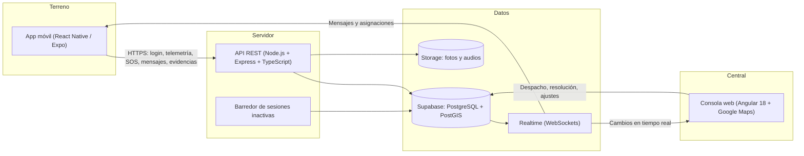
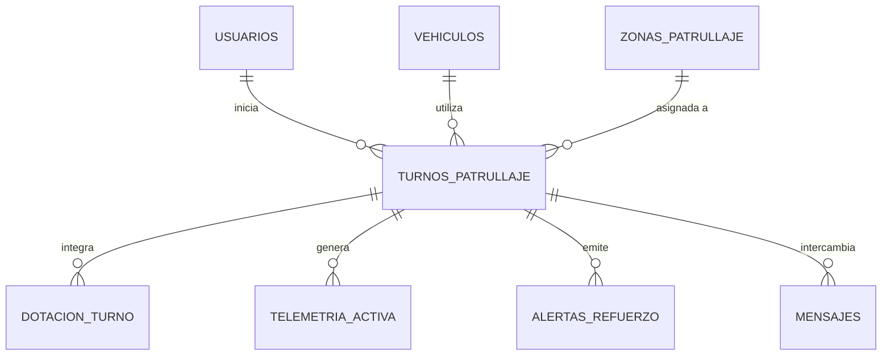
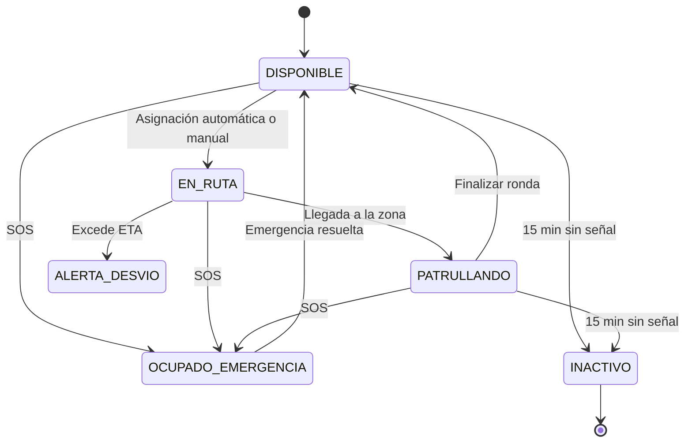

# INFORME TÉCNICO DE ITERACIÓN 2 (SPRINT 2 — HITO 2)
## S.I.G.O. — Sistema Inteligente de Gestión Operativa
### Plataforma geoespacial de patrullaje preventivo y supervisión reactiva en lazo cerrado

| Campo | Detalle |
|---|---|
| Proyecto | Sistema Inteligente de Gestión Operativa (S.I.G.O.) |
| Iteración | 2 (Hito 2) |
| Repositorio | `AxelLyan-lab/Sistema-Inteligente-de-Gestion-Operativa` |
| Rama del incremento | `feat/sprint2-patrullaje-reactivo-sos` |
| Gestión del backlog | Taiga — hito (milestone) 533012 |
| Informe anterior | `Informe_Tecnico_Iteracion_1.md` |

> **Nota de uso.** Los campos marcados como `[COMPLETAR]` requieren datos o capturas que solo posee el equipo (fechas exactas de ceremonias, capturas del tablero Taiga, horas reales). Todo lo demás está respaldado por el repositorio y por el trabajo realizado durante la iteración.

---

## ÍNDICE

1. Iteración 2
2. Duración y meta del sprint
3. Funcionalidades a realizar
4. Historias de usuario a realizar
5. Puntos de historia comprometidos
6. Definición del sprint backlog
7. Diseño detallado
8. Riesgos gatillados
9. Ejecución de pruebas
10. Evidencia de monitoreo y control del sprint
11. Evidencia de liberación del MVP
12. Problemas abiertos

---

## 1. ITERACIÓN 2

### 1.1 Contexto

La Iteración 1 entregó la base geoespacial del sistema: persistencia con PostGIS, cartografía base y mapas de calor dinámicos en una consola web (HU01, HU02, HU03). Esa consola permitía **observar** el territorio, pero aún no **cerraba el ciclo** con el funcionario en terreno.

La Iteración 2 construye el segundo extremo del sistema: una **aplicación móvil** para el funcionario y el **canal de comunicación bidireccional** con la central. Con ello el sistema pasa de ser un visualizador a ser una plataforma de **lazo cerrado**:

```
Mapa de calor → Asignación de zona → Funcionario en terreno → Telemetría GPS
      ↑                                                              ↓
Cierre de ronda ← Evidencias / Mensajes / SOS ← Supervisor reacciona ←
```

### 1.2 Resultado de la Iteración 1 que condiciona la Iteración 2

| Aspecto del Sprint 1 | Consecuencia para el Sprint 2 |
|---|---|
| Existía solo la consola web | Era necesario priorizar la app móvil y el canal en tiempo real |
| Despacho de unidades solo automático | Se incorporó el despacho manual y su coexistencia con el automático |
| Alertas SOS simuladas | Se implementó el flujo SOS real, con alarma y refuerzos |
| Sin autenticación diferenciada | Se incorporó control de acceso por roles (HU09) |

---

## 2. DURACIÓN Y META DEL SPRINT

### 2.1 Duración

| Parámetro | Valor |
|---|---|
| Inicio (aprox.) | 28-09-2026 (primer commit de la app móvil) `[CONFIRMAR]` |
| Cierre | 21-10-2026 (liberación del incremento en la rama del sprint) |
| Duración | ~3 semanas y media |
| Tamaño del equipo | `[COMPLETAR]` integrantes |
| Capacidad comprometida | 49 puntos de historia |
| Ceremonias | Planificación, seguimiento semanal, revisión y retrospectiva `[COMPLETAR fechas]` |

### 2.2 Meta del sprint (Sprint Goal)

> **Al cierre de la iteración, un funcionario en terreno puede iniciar turno desde su teléfono, ser rastreado en tiempo real, recibir asignaciones, y comunicarse con la central mediante mensajes, evidencias fotográficas y un botón de emergencia (SOS); y el supervisor puede reaccionar desde la consola web, despachando unidades o refuerzos y cerrando la ronda de forma inmediata.**

**Criterios de medición de la meta** (verificables):

| Criterio | Indicador de cumplimiento |
|---|---|
| Autenticación móvil operativa | Un funcionario inicia sesión en la app con su RUT |
| Rastreo en tiempo real | La posición del móvil aparece en el mapa de la consola sin recargar |
| Emergencia | Una alerta SOS activa una alarma en la consola en pocos segundos |
| Comunicación | Mensajes, notas de voz y fotos llegan a la central |
| Cierre de ciclo | Al finalizar la ronda, la zona se desmarca de inmediato |

### 2.3 Alineación con el producto

La meta responde directamente al objetivo del producto: **optimizar la cobertura territorial y coordinar unidades en terreno con baja latencia**. Se priorizó lo que permite demostrar el ciclo completo de patrullaje (asignar → ejecutar → reportar → cerrar) por sobre funciones accesorias.

---

## 3. FUNCIONALIDADES A REALIZAR

| ID | Funcionalidad | Componente | Prioridad |
|---|---|---|---|
| F1 | Inicio de sesión del funcionario con RUT y selección de vehículo | App móvil + API | Alta |
| F2 | Control de acceso por rol (supervisor / patrullero) | Web + API + BD | Alta |
| F3 | Telemetría GPS en primer y segundo plano | App móvil + API | Alta |
| F4 | Alertas de desvío o atraso respecto de la zona asignada | Web | Alta |
| F5 | Botón SOS con alarma y solicitud de refuerzos | App + API + Web | Alta |
| F6 | Envío de fotos y evidencias clasificadas | App + API + Web | Media |
| F7 | Mensajería de texto y notas de voz bidireccional | App + API + Web | Media |
| F8 | Despacho manual a zona y finalización inmediata de ronda | Web + API | Alta |
| F9 | Registro de vehículo y tripulación de servicio | App + API + Web | Media |
| F10 | Ajustes de rotación (cantidad de zonas y temporizador), tema y sonidos | Web | Baja |

---

## 4. HISTORIAS DE USUARIO A REALIZAR

Las historias se redactaron en lenguaje de negocio y con criterios de aceptación verificables (formato Dado/Cuando/Entonces a nivel de tarea). El detalle completo, con tareas y criterios, se encuentra en el documento de historias del Hito 2.

| HU | Historia | Funcionalidad | Criterio de aceptación principal (resumen) |
|---|---|---|---|
| **HU07** | Distribución reactiva de alertas de desvío | F4 | Si el móvil excede el tiempo de traslado (ETA) o no entra a su zona, la consola muestra una alerta visual con cronómetro. |
| **HU09** | Control de acceso y roles | F2 | Un usuario sin sesión es redirigido al login; un patrullero no accede a la consola web; cada patrullero ve solo sus datos. |
| **HU13** | Autenticación de funcionario en terreno | F1 | El funcionario ingresa con RUT y contraseña, elige su vehículo y accede a su turno. |
| **HU14** | Telemetría GPS en app móvil | F3 | La ubicación se transmite con la app abierta y en segundo plano, y se almacena como historial. |
| **HU16** | Botón SOS y solicitud de refuerzos | F5 | Al confirmar el SOS suena una alarma en la consola y se marca la posición; "Emergencia resuelta" la apaga de inmediato. |
| **HU17** | Fotos y evidencias desde terreno | F6 | El funcionario envía una foto con tipo y descripción; el supervisor la visualiza ampliada. |
| **HU18** | Mensajería táctica y notas de voz | F7 | Los mensajes llegan sin recargar; el audio se reproduce en la consola; se muestra contador de no leídos. |
| **HU19** | Despacho manual y fin de ronda | F8, F10 | El supervisor envía una unidad a una zona; al finalizar la ronda la zona se desmarca al instante. |
| **HU20** | Registro de vehículo y tripulación | F9 | El conductor registra acompañantes; la consola muestra la dotación; el turno inactivo se cierra tras 15 min sin señal. |

### 4.1 Trazabilidad HU → Funcionalidad → Componentes

| HU | App móvil | API | Consola web | Base de datos |
|---|:---:|:---:|:---:|:---:|
| HU07 | – | ✔ | ✔ | ✔ |
| HU09 | ✔ | ✔ | ✔ | ✔ |
| HU13 | ✔ | ✔ | – | ✔ |
| HU14 | ✔ | ✔ | ✔ | ✔ |
| HU16 | ✔ | ✔ | ✔ | ✔ |
| HU17 | ✔ | ✔ | ✔ | ✔ |
| HU18 | ✔ | ✔ | ✔ | ✔ |
| HU19 | – | ✔ | ✔ | ✔ |
| HU20 | ✔ | ✔ | ✔ | ✔ |

---

## 5. PUNTOS DE HISTORIA COMPROMETIDOS

Estimación en puntos de historia con desglose por rol (UX, Diseño, Front, Back), según el esquema de Taiga. Se utilizó una escala tipo Fibonacci acotada (3, 5, 8) como referencia de complejidad relativa.

| HU | Historia | UX | Diseñador | Front | Back | **Total** |
|:---:|---|:---:|:---:|:---:|:---:|:---:|
| HU13 | Autenticación de funcionario | 1 | 1 | 2 | 1 | **5** |
| HU14 | Telemetría GPS | 1 | 1 | 3 | 3 | **8** |
| HU07 | Alertas de desvío | 1 | 1 | 2 | 1 | **5** |
| HU09 | Control de acceso y roles | 1 | 1 | 1 | 2 | **5** |
| HU16 | SOS y refuerzos | 1 | 1 | 3 | 3 | **8** |
| HU17 | Fotos y evidencias | 1 | 1 | 2 | 1 | **5** |
| HU18 | Mensajería y notas de voz | 1 | 1 | 2 | 1 | **5** |
| HU19 | Despacho manual y fin de ronda | 1 | 1 | 2 | 1 | **5** |
| HU20 | Vehículo y tripulación | 0,5 | 0,5 | 1 | 1 | **3** |
| | **TOTAL** | **8,5** | **8,5** | **18** | **14** | **49** |

> **Corrección respecto de un borrador previo.** Una versión anterior de la tabla resumen indicaba 44 puntos. La suma correcta de las historias es **49 puntos** (5+8+5+5+8+5+5+5+3), y la suma por rol es 8,5 + 8,5 + 18 + 14 = 49. Este informe adopta el valor corregido.

### 5.1 Criterios de consistencia de la estimación

- **Back alto (3)** en HU14 y HU16: involucran flujo en tiempo real, persistencia espacial y reglas de estado.
- **Front alto (3)** en HU14 y HU16: la app captura GPS en segundo plano y la consola reacciona con alarma y mapa.
- **5 puntos** para historias con un flujo completo app → API → consola sin lógica espacial compleja.
- **3 puntos** para HU20, de alcance acotado (formulario + visualización + rutina de cierre).

---

## 6. DEFINICIÓN DEL SPRINT BACKLOG

### 6.1 Desglose en tareas

Cada historia se descompone en tareas técnicas con horas estimadas, estado, dependencias y relación con la meta del sprint.

| Tarea | Descripción | HU | Horas | Depende de | Aporta a la meta | Estado |
|:---:|---|:---:|:---:|:---:|---|:---:|
| #37–#40 | Detección de entrada a zona, emisión de alerta de atraso, diseño y avisos emergentes | HU07 | `[COMPLETAR]` | HU14 | Reacción del supervisor | Hecho |
| #41–#44 | Pantalla de login móvil, permisos, validación de credenciales, sesión segura | HU13 | `[COMPLETAR]` | – | Acceso del funcionario | Hecho |
| #45–#49 | Panel GPS, captura, segundo plano, recepción en web, historial | HU14 | `[COMPLETAR]` | HU13 | Rastreo en tiempo real | Hecho |
| #54 | Bloqueo de acceso no autorizado en web | HU09 | 5 | HU13 | Seguridad | Hecho |
| #55 | Control de roles en el servidor | HU09 | 5 | #54 | Seguridad | Hecho |
| #56 | Pantalla de administración de usuarios | HU09 | 6 | #55 | Seguridad | Hecho |
| #57 | Permisos de privacidad en base de datos | HU09 | 4 | #55 | Seguridad | Hecho |
| #63 | Botón SOS con confirmación (app) | HU16 | 5 | HU13 | Emergencia | Hecho |
| #64 | Envío de emergencia con ubicación | HU16 | 4 | #63, HU14 | Emergencia | Hecho |
| #65 | Sirena y marcador rojo en la web | HU16 | 6 | #64 | Emergencia | Hecho |
| #66 | Despacho de refuerzos | HU16 | 6 | #65 | Emergencia | Hecho |
| #67 | Botón "Emergencia resuelta" | HU16 | 5 | #65 | Emergencia | Hecho |
| #68 | Captura/selección de fotos (app) | HU17 | 5 | HU13 | Comunicación | Hecho |
| #69 | Almacenamiento de fotos en la nube | HU17 | 5 | #68 | Comunicación | Hecho |
| #70 | Clasificación del reporte | HU17 | 4 | #68 | Comunicación | Hecho |
| #71 | Panel web de evidencias | HU17 | 4 | #69 | Comunicación | Hecho |
| #72 | Grabación de notas de voz (app) | HU18 | 5 | HU13 | Comunicación | Hecho |
| #73 | Pantalla de chat (app) | HU18 | 4 | HU13 | Comunicación | Hecho |
| #74 | Mensajería y reproductor (web) | HU18 | 5 | #73 | Comunicación | Hecho |
| #75 | Notificaciones y contador no leídos | HU18 | 3 | #74 | Comunicación | Hecho |
| #76 | Ventana de despacho manual | HU19 | 5 | HU14 | Cierre del ciclo | Hecho |
| #77 | Configuración de rotación de zonas | HU19 | 5 | – | Cierre del ciclo | Hecho |
| #78 | Finalizar ronda con desmarcado inmediato | HU19 | 5 | #76 | Cierre del ciclo | Hecho |
| #79 | Exclusión de zonas manuales del ciclo automático | HU19 | 4 | #76 | Cierre del ciclo | Hecho |
| #80 | Lista de acompañantes (app) | HU20 | 4 | HU13 | Trazabilidad | Hecho |
| #81 | Visualización de tripulación (web) | HU20 | 4 | #80 | Trazabilidad | Hecho |
| #82 | Cierre automático de turnos inactivos | HU20 | 3 | HU14 | Trazabilidad | Hecho |

**Resumen del backlog:** 37 tareas; horas de HU09, HU16–HU20 = **111 h**. Las horas de HU07, HU13 y HU14 se obtienen del tablero de Taiga `[COMPLETAR]`.

### 6.2 Orden de ejecución (camino crítico)

`HU13 (login)` → `HU14 (telemetría)` → `HU07 / HU19 (reacción y despacho)` → `HU16 (SOS)`; en paralelo `HU17`, `HU18`, `HU20` una vez disponible la sesión autenticada. HU09 se ejecutó de forma transversal por tratarse de seguridad.

---

## 7. DISEÑO DETALLADO

### 7.1 Arquitectura de componentes



**Decisión de diseño.** La app móvil se comunica con la base mediante la API (que valida identidad y reglas), mientras la consola se suscribe a cambios con Realtime. Esto separa la lógica sensible (autenticación, sesiones, evidencias) de la presentación reactiva.

### 7.2 Componentes por capa

| Capa | Componentes principales |
|---|---|
| **App móvil** | Pantallas: Login, Inicio (turno, GPS, SOS), Mensajes, Evidencias, Perfil. Servicios: autenticación, telemetría GNSS, audio, sonido, evidencias, insignia de mensajes. Contextos de autenticación y tema. |
| **API** | Rutas: `/auth`, `/patrol`, `/evidence`, `/sesiones`. Controladores de autenticación, patrulla, evidencias, misiones y sesiones. Utilidades: JWT y barredor de sesiones. |
| **Consola web** | Módulos: Dashboard (mapa), Unidades, Zonas, Mensajes, Evidencias, Usuarios, Reportes, Ajustes. Servicios: mapa, autenticación, sonido, tema, ajustes, MQTT, Supabase. Store de estado del dashboard (Signals). |
| **Base de datos** | Tablas: `turnos_patrullaje`, `vehiculos`, `dotacion_turno`, `telemetria_activa`, `zonas_patrullaje`, `alertas_refuerzo`, `mensajes`. Políticas RLS y suscripciones Realtime. |

### 7.3 Interfaces principales de la API

| Método y ruta | Función | Historia |
|---|---|---|
| `POST /auth/verify-credentials`, `POST /auth/patrol-login` | Validar credenciales e iniciar turno | HU13 |
| `GET /auth/vehicles` | Listar vehículos disponibles | HU13, HU20 |
| `POST /auth/validate-companion`, `POST /patrol/crew/add`, `DELETE /patrol/crew/:rut` | Gestionar tripulación | HU20 |
| `GET /auth/me`, `POST /auth/logout` | Sesión y cierre de turno | HU13, HU09 |
| `POST /patrol/telemetry`, `GET /patrol/telemetry/status` | Enviar y consultar telemetría | HU14 |
| `GET /patrol/assignment`, `POST /patrol/assignment/arrived` | Asignación activa y llegada a zona | HU07, HU19 |
| `POST /patrol/sos` | Solicitud de refuerzos | HU16 |
| `GET /patrol/messages`, `POST /patrol/message`, `POST /patrol/message/audio` | Mensajería y notas de voz | HU18 |
| `POST /evidence/upload`, `GET /evidence/list` | Evidencias | HU17 |
| `GET /sesiones/activas`, `GET /sesiones/:id` | Sesiones operativas para la consola | HU09, HU14 |

### 7.4 Modelo de datos (vista lógica)



La telemetría se almacena como geometría PostGIS con índice espacial GiST (heredado del Sprint 1), lo que permite consultas de pertenencia a zona y de cercanía eficientes.

### 7.5 Máquina de estados de la unidad



### 7.6 Decisiones técnicas relevantes

| Decisión | Justificación |
|---|---|
| Rotación automática de zonas con exclusión de zonas manuales | Evita que el algoritmo reasigne una zona ya cubierta por despacho manual (defecto D-02). |
| Desmarcado inmediato de zona al finalizar ronda | La interfaz actualiza el estado local de forma optimista y luego se persiste, logrando respuesta menor a 1 s (defecto D-04). |
| Cierre automático de sesiones a los 15 minutos | Evita datos de patrullaje falsos por dispositivos apagados. |
| Notas de voz y fotos en almacenamiento de objetos | Mantiene la base relacional liviana; se entrega un enlace al supervisor. |
| Credenciales y claves en variables de entorno (`.env`, excluidas del repositorio) | Evita exponer secretos en control de versiones. |
| Túnel HTTPS para exponer la API al teléfono en desarrollo | Permite probar en dispositivos reales fuera de la red local. |

---

## 8. RIESGOS GATILLADOS

Se registran los riesgos que **se materializaron** durante la iteración y los que permanecen vigentes, evaluados según su efecto en el **usuario** (supervisor y funcionario en terreno) y en el **desarrollo**. Escala: probabilidad e impacto en Bajo / Medio / Alto. Prioridad = probabilidad × impacto.

### 8.1 Riesgos materializados

| ID | Riesgo | Efecto en el usuario / desarrollo | Prob. | Impacto | Prioridad | Responsable | Acción ejecutada | Estado |
|:---:|---|---|:---:|:---:|:---:|---|---|:---:|
| R1 | La app móvil no logra comunicarse con el servidor desde un teléfono real | El funcionario no puede iniciar turno ni transmitir GPS ni SOS: el sistema queda **inutilizable en terreno** | Alta | Alto | **Crítica** | Back / Móvil | Exposición de la API por HTTPS y URL configurable por variable de entorno | **Mitigado** |
| R2 | La asignación automática entrega una cantidad de zonas distinta a la configurada (4 en vez de 3) | El supervisor recibe un mapa de riesgo **poco confiable**, núcleo del producto; se pierde la cobertura planificada | Media | Alto | **Alta** | Back / Front | Rediseño del cálculo de cupos considerando zonas ocupadas y liberadas | **Cerrado** |
| R3 | La zona de riesgo o la emergencia no se desmarca al finalizar la ronda o resolver el SOS | La central opera con **información falsa**: sigue mostrando emergencias y zonas ya atendidas, y las unidades quedan bloqueadas; el flujo de cierre **no funciona** | Alta | Alto | **Crítica** | Front / Back | Desmarcado inmediato y limpieza del estado en consola y base de datos | **Cerrado** |
| R4 | El ciclo automático vuelve a elegir una zona que ya cubre un móvil asignado manualmente | Doble cobertura de una zona y otras zonas sin patrullar; el despacho manual **pierde sentido** | Media | Alto | **Alta** | Back | Exclusión de zonas manuales en la selección automática | **Cerrado** |

### 8.2 Riesgos vigentes para la próxima iteración

| ID | Riesgo | Efecto en el usuario / desarrollo | Prob. | Impacto | Prioridad | Acción propuesta | Estado |
|:---:|---|---|:---:|:---:|:---:|---|:---:|
| R5 | **Pérdida de señal GPS o cierre de la app por el sistema operativo** (ahorro de batería, segundo plano, batería agotada) | La unidad **desaparece del mapa** y a los 15 minutos su turno se cierra aunque siga en servicio | Alta | Alto | **Crítica** | Servicio en primer plano con notificación persistente, ajuste de frecuencia de muestreo y alerta "sin señal" en la consola antes del cierre | Abierto |
| R6 | **El SOS no llega por falta de cobertura móvil** en el sector de patrullaje | El funcionario cree haber pedido auxilio y la central **no se entera**; riesgo para la vida | Media | Alto | **Crítica** | Cola de reintentos con envío al recuperar señal, indicador de "alerta enviada / no enviada" en la app y alerta en la consola ante pérdida de conexión de la unidad | Abierto |
| R7 | **Acceso indebido a datos sensibles** por políticas de seguridad de filas permisivas (ubicaciones, evidencias, mensajes) | Un usuario autenticado podría consultar información de otros funcionarios; **filtración de datos institucionales** | Media | Alto | **Alta** | Políticas RLS por rol y por usuario, expiración y revocación de tokens, revisión de permisos antes de producción | Abierto |
| R8 | **Caída del servidor o del túnel durante la operación** | La central queda **a ciegas**: sin telemetría, sin SOS y sin mensajería hasta restablecer | Media | Alto | **Alta** | Despliegue en servicio con URL fija y reinicio automático, verificación de estado (`health check`) y aviso en la consola de "conexión perdida" | Abierto |
| R9 | **Degradación del rendimiento con muchas unidades simultáneas** | Mapa con retardo y SOS que supera el objetivo de 2 s; la consola puede **congelarse** | Media | Alto | **Alta** | Pruebas de carga con unidades simuladas, limitar la frecuencia de actualización del mapa y paginar consultas | Abierto |
| R10 | **Regresiones al modificar la lógica de zonas y estados** por ausencia de pruebas automatizadas | Reaparición de defectos ya corregidos (R2, R3, R4); cada cambio exige repetir pruebas manuales y **ralentiza al equipo** | Alta | Medio | **Alta** | Pruebas unitarias del algoritmo de asignación y de la máquina de estados; pruebas de integración de la API | Abierto |

---

## 9. EJECUCIÓN DE PRUEBAS

### 9.1 Estrategia

Se aplicaron **pruebas funcionales manuales de extremo a extremo** sobre el sistema integrado (app móvil + API + consola web + base de datos), con casos derivados de los criterios de aceptación de cada historia. Tras cada corrección de defecto se repitió el caso afectado y los casos relacionados (regresión manual).

| Tipo de prueba | ¿Qué verifica? | ¿Cómo se realizó? | Estado |
|---|---|---|:---:|
| **Funcional** | Que cada historia de usuario (HU07 a HU20) cumpla sus criterios de aceptación | Manualmente, usando un teléfono real y la consola web | Realizada |
| **Integración** | Que la app móvil, el servidor, la base de datos y la consola web funcionen juntos y en tiempo real | Manualmente, ejecutando el flujo completo (por ejemplo: SOS en la app y alarma en la consola) | Realizada |
| **Regresión** | Que una corrección no dañe lo que ya funcionaba | Manualmente, repitiendo los casos afectados después de cada corrección | Realizada |
| **Automatizada** | Que las pruebas se ejecuten solas mediante código | No se implementó en este sprint (ver riesgo R10) | Pendiente |

### 9.2 Casos de prueba y resultados

| ID | HU | Caso de prueba | Resultado esperado | Resultado |
|:---:|:---:|---|---|:---:|
| CP-01 | HU13 | Iniciar sesión con RUT válido y elegir vehículo | Acceso al turno | Aprobado |
| CP-02 | HU13 | Iniciar sesión con credenciales inválidas | Rechazo con mensaje | Aprobado |
| CP-03 | HU09 | Abrir `/dashboard` sin sesión | Redirección a login | Aprobado |
| CP-04 | HU09 | Patrullero intenta ingresar a la consola | Rechazo por permisos | Aprobado |
| CP-05 | HU14 | Enviar GPS con app abierta | Marcador visible en el mapa | Aprobado |
| CP-06 | HU14 | Enviar GPS con pantalla bloqueada | Posición sigue actualizándose | Aprobado |
| CP-07 | HU07 | Unidad excede tiempo de traslado | Alerta visual con cronómetro | Aprobado |
| CP-08 | HU16 | Confirmar SOS | Alarma y marcador rojo en la consola | Aprobado |
| CP-09 | HU16 | Presionar "Emergencia resuelta" | Alarma y marcador se apagan de inmediato | Aprobado tras corrección (D-03) |
| CP-10 | HU17 | Enviar foto con tipo y descripción | Visible y ampliable en la consola | Aprobado |
| CP-11 | HU18 | Enviar mensaje y nota de voz | Recepción sin recargar; audio reproducible | Aprobado |
| CP-12 | HU18 | Mensaje nuevo con consola abierta | Aviso emergente y contador | Aprobado |
| CP-13 | HU19 | Despachar unidad a zona manualmente | Estado "En ruta" | Aprobado |
| CP-14 | HU19 | Finalizar ronda de zona manual | Zona se desmarca de inmediato | Aprobado tras corrección (D-04) |
| CP-15 | HU19 | Configurar 3 zonas automáticas con 1 manual y esperar rotación | La zona manual no se reselecciona | Aprobado tras corrección (D-02) |
| CP-16 | HU19 | Modo automático, liberar unidad real de su zona y esperar rotación | Se mantienen 3 zonas | Aprobado tras corrección (D-01) |
| CP-17 | HU20 | Registrar acompañantes por RUT | Dotación visible en consola | Aprobado |
| CP-18 | HU20 | Dejar un dispositivo 15 min sin señal | Sesión cerrada y zona liberada | Aprobado |

> `[COMPLETAR]` Adjuntar capturas o video por cada caso como evidencia (carpeta `Evidencias/Sprint2/`).

### 9.3 Gestión de defectos

| ID | Problema (lo que veía el usuario) | Severidad | Causa (por qué ocurría) | Solución | Estado |
|:---:|---|:---:|---|---|:---:|
| D-01 | Se configuraban 3 zonas de riesgo, pero al liberar a un móvil de su zona aparecía una cuarta zona. | Alta | El sistema seguía contando la zona liberada y, además, agregaba zonas nuevas. | Ahora cuenta primero las zonas ocupadas y solo completa las que faltan hasta llegar a 3. | Corregido |
| D-02 | Una zona enviada manualmente a un móvil también podía ser elegida por la asignación automática. | Media | El sistema automático no sabía que esa zona ya tenía un móvil asignado a mano. | La asignación automática ahora ignora las zonas que tienen un móvil manual. | Corregido |
| D-03 | Al presionar "Emergencia resuelta", la pantalla del supervisor seguía mostrando la emergencia y la alarma. | Media | La emergencia se cerraba internamente, pero la pantalla no se actualizaba. | Al resolverla, la alerta desaparece de la pantalla y la alarma se detiene al instante. | Corregido |
| D-04 | Al presionar "Finalizar ronda", la zona seguía marcada como de riesgo en el mapa, aunque el móvil ya había terminado. | Media | El mapa solo se actualizaba cuando el reloj de rotación llegaba a cero. | Al finalizar la ronda, la zona se desmarca de inmediato. | Corregido |
| D-05 | La app del teléfono mostraba "sin conexión con el servidor", aunque el servidor estaba funcionando. | Alta | El servidor funcionaba solo dentro del computador y el teléfono no tenía cómo llegar a él. | Se habilitó una dirección de internet segura para el servidor y se configuró en la app. | Corregido |

### 9.4 Cobertura y análisis

**a) Cobertura por historia de usuario**

| Historia | Casos ejecutados | Resultado |
|:---:|---|:---:|
| HU07 | CP-07 | Aprobado |
| HU09 | CP-03, CP-04 | Aprobado |
| HU13 | CP-01, CP-02 | Aprobado |
| HU14 | CP-05, CP-06 | Aprobado |
| HU16 | CP-08, CP-09 | Aprobado (CP-09 tras corrección) |
| HU17 | CP-10 | Aprobado |
| HU18 | CP-11, CP-12 | Aprobado |
| HU19 | CP-13, CP-14, CP-15, CP-16 | Aprobado (CP-14, CP-15 y CP-16 tras corrección) |
| HU20 | CP-17, CP-18 | Aprobado |

**b) Resumen de resultados**

- **Cobertura funcional:** las 9 historias tienen al menos un caso de prueba; en total se ejecutaron **18 casos**.
- **Resultado final:** los 18 casos quedaron aprobados al cierre del sprint. De ellos, 4 (CP-09, CP-14, CP-15 y CP-16) fallaron al inicio, se corrigieron y se volvieron a ejecutar con éxito.
- **Defectos:** se encontraron 5 (2 de severidad alta y 3 de severidad media). Los 5 fueron corregidos y verificados.

**c) Análisis**

- **Dónde se concentraron los errores:** 3 de los 5 defectos (D-01, D-02 y D-04) pertenecen a HU19, la historia de despacho manual y zonas. Es la parte más compleja del sistema, porque combina la asignación automática, la asignación manual y el reloj de rotación. Por eso recibió más pruebas (4 casos).
- **Tipo de errores:** la mayoría fueron de **actualización de estado** (la pantalla no reflejaba un cambio en el momento), no de cálculos ni de diseño. Esto indica que el siguiente foco de calidad debe ser verificar que cada acción del supervisor se vea reflejada de inmediato.
- **Efecto de las correcciones:** después de cada corrección se repitieron los casos relacionados, y no se detectaron fallas nuevas.

**d) Limitaciones**

- Todas las pruebas fueron manuales; no existen pruebas automáticas (riesgo R10).
- No se realizaron pruebas de carga con muchas unidades al mismo tiempo (riesgo R9).
- No se midió el consumo de batería del teléfono con el GPS activo por tiempos prolongados (riesgo R5).
- No se realizaron pruebas de seguridad formales sobre los permisos de acceso a los datos (riesgo R7).

---

## 10. EVIDENCIA DE MONITOREO Y CONTROL DEL SPRINT

### 10.1 Mecanismos de seguimiento

En simple: el avance del sprint se controló con cinco herramientas. Cada una responde a una pregunta distinta y deja una evidencia que se puede revisar.

| Herramienta | ¿Para qué sirvió? | ¿Dónde está la evidencia? |
|---|---|---|
| **Tablero Taiga** (hito 533012) | Ver qué historias y tareas estaban pendientes, en curso o terminadas | `[COMPLETAR]` captura del tablero |
| **GitHub** (commits y ramas) | Comprobar el avance real: cada cambio queda guardado con su fecha | Sección 11 |
| **Revisión final del producto** | Confirmar que lo construido funciona de verdad, probándolo con teléfono y consola | `[COMPLETAR]` acta o fecha de la revisión |
| **Lista de defectos** | Registrar los errores encontrados y cómo se corrigieron | Sección 9.3 |
| **Lista de riesgos** | Anticipar problemas que podían afectar al proyecto y revisarlos durante el sprint | Sección 8 |

### 10.2 Avance por historia

| HU | Pts | Tareas | Completadas | % |
|:---:|:---:|:---:|:---:|:---:|
| HU07 | 5 | 4 | 4 | 100 |
| HU13 | 5 | 4 | 4 | 100 |
| HU14 | 8 | 5 | 5 | 100 |
| HU09 | 5 | 4 | 4 | 100 |
| HU16 | 8 | 5 | 5 | 100 |
| HU17 | 5 | 4 | 4 | 100 |
| HU18 | 5 | 4 | 4 | 100 |
| HU19 | 5 | 4 | 4 | 100 |
| HU20 | 3 | 3 | 3 | 100 |
| **Total** | **49** | **37** | **37** | **100** |

### 10.3 Decisiones y bloqueos registrados

| Fecha | Evento | Decisión |
|---|---|---|
| `[COMPLETAR]` | La app no conectaba con el servidor | Exponer la API mediante túnel HTTPS |
| `[COMPLETAR]` | Inconsistencias en rotación de zonas | Rediseñar cálculo de cupos y exclusiones |
| `[COMPLETAR]` | Retardo visual al finalizar ronda | Desmarcado inmediato (HU19) |
| 21-10-2026 | Reorganización de carpetas | `patrol-app`→`sigo-app`, `patrol-api`→`sigo-api`, `dashboard-web`→`frontend` |

### 10.4 Ceremonias

| Ceremonia | Fecha | Participantes | Evidencia |
|---|---|---|---|
| Planificación | `[COMPLETAR]` | `[COMPLETAR]` | Acta |
| Seguimiento semanal | `[COMPLETAR]` | `[COMPLETAR]` | Acta |
| Revisión | `[COMPLETAR]` | `[COMPLETAR]` | Acta |
| Retrospectiva | Sección 12.3 | Equipo | Este informe |

---

## 11. EVIDENCIA DE LIBERACIÓN DEL MVP

### 11.1 Control de versiones

| Rama | Propósito |
|---|---|
| `main` | Línea estable |
| `feat/hu13-app-movil-autenticacion` | App móvil y autenticación (Hito 2, inicio) |
| `feat/supervision-y-patrullaje-reactivo` | Consolidado local del sprint |
| `feat/sprint2-patrullaje-reactivo-sos` | **Rama de liberación del incremento del Sprint 2** |

| Commit | Fecha | Descripción |
|---|---|---|
| `d2fde09` | 10-09-2026 | Sprint 1: persistencia PostGIS, cartografía y mapas de calor |
| `2822d2c` | 28-09-2026 | App móvil y autenticación de funcionario |
| `a8dbf86` | 21-10-2026 | Supervisión operativa y patrullaje reactivo en tiempo real |
| `a549390` | 21-10-2026 | Patrullaje reactivo, SOS, evidencias y mensajería; reorganización de carpetas |

Solicitud de integración (pull request) sugerida: `feat/sprint2-patrullaje-reactivo-sos` → `main`.

### 11.2 Estructura entregada

```text
├── Documentos Informacion/      # Informes y planes
├── Proyecto/
│   ├── sigo-app/                # App móvil (Expo)
│   ├── sigo-api/                # API y scripts SQL
│   └── frontend/                # Consola web (Angular)
├── README.md                    # Sprint 1
└── README_SPRINT2.md            # Sprint 2
```

### 11.3 Ejecución y Puesta en Marcha del MVP

Para ejecutar el entorno completo e interactuar entre la consola de mando web y la aplicación móvil en un dispositivo físico real, el sistema requiere la inicialización de **4 procesos concurrentes en terminales independientes**, siguiendo el orden de dependencias:

#### 1. Prerrequisitos de configuración (`.env`)
Cada componente debe contar con sus variables de entorno configuradas previamente:
* **`Proyecto/sigo-api/.env`**: credenciales de conexión con Supabase (URL, Service Role Key, JWT Secret) y puerto (`PORT=3000`).
* **`Proyecto/frontend/.env`**: credenciales de Supabase y API Key de Google Maps para el renderizado cartográfico.
* **`Proyecto/sigo-app/.env.local`**: variable `EXPO_PUBLIC_API_URL` con la URL HTTPS pública generada por el túnel y `EXPO_PUBLIC_GOOGLE_MAPS_API_KEY`.

---

#### 2. Secuencia de inicialización (4 terminales independientes)

* **Terminal 1 — Servidor Backend (`sigo-api`):**
  Inicia el servidor Node.js/Express con recarga automática:
  ```bash
  cd Proyecto/sigo-api
  npm run dev
  # Servicio operativo en: http://localhost:3000
  ```

* **Terminal 2 — Enlace Seguro HTTPS para Móviles (`cloudflared`):**
  Expone el puerto 3000 del backend a internet mediante un túnel seguro cifrado, permitiendo que un dispositivo móvil físico conectado por red móvil (4G/5G) o Wi-Fi externa se comunique con la API:
  ```bash
  cloudflared tunnel --url http://localhost:3000
  # Genera una URL temporal (ej: https://subdominio.trycloudflare.com)
  # Esta URL se copia en Proyecto/sigo-app/.env.local en la variable EXPO_PUBLIC_API_URL
  ```

* **Terminal 3 — Consola Web del Supervisor (`frontend`):**
  Compila y levanta la plataforma Angular 18 en modo observador:
  ```bash
  cd Proyecto/frontend
  npm start
  # Disponible en navegador web: http://localhost:4200
  ```

* **Terminal 4 — Aplicación Móvil del Funcionario (`sigo-app`):**
  Inicia el empaquetador Metro y el túnel de Expo para desplegar la app en teléfonos reales:
  ```bash
  cd Proyecto/sigo-app
  npx expo start --tunnel -c
  # Genera el código QR para escanear desde la app 'Expo Go' en Android o iOS
  ```

### 11.4 Incremento funcional liberado

| Capacidad | Estado |
|---|---|
| Inicio de turno móvil con selección de vehículo y tripulación | Operativa |
| Telemetría GPS en tiempo real y en segundo plano | Operativa |
| Alertas de desvío en la consola | Operativa |
| SOS con alarma, refuerzos y cierre de emergencia | Operativa |
| Evidencias fotográficas y mensajería con notas de voz | Operativa |
| Despacho manual, rotación configurable y fin de ronda inmediato | Operativa |
| Control de acceso por roles y administración de usuarios | Operativa |
| Cierre automático de sesiones inactivas | Operativa |

### 11.5 Planificado vs. ejecutado

| Indicador | Planificado | Ejecutado | Desviación |
|---|:---:|:---:|:---:|
| Puntos de historia | 49 | 49 | 0 |
| Historias | 9 | 9 | 0 |
| Tareas | 37 | 37 | 0 |
| Defectos corregidos | – | 5 de 5 | – |

**Análisis.** Se cumplió el alcance comprometido. El esfuerzo no previsto se concentró en estabilización (defectos D-01 a D-05) y en la reorganización del repositorio. Las horas reales por tarea `[COMPLETAR]` permitirán calcular la desviación de esfuerzo.

### 11.6 Capturas de evidencia `[COMPLETAR]`

1. Pantalla de login y turno (app).
2. Mapa con unidades y zonas (consola).
3. SOS activo con alarma.
4. Evidencia ampliada y chat con nota de voz.
5. Despacho manual y finalización de ronda.
6. Tablero Taiga con el hito cerrado.

---

## 12. PROBLEMAS ABIERTOS

### 12.1 Registro

| ID | Problema | Impacto | Prioridad | Acción propuesta | Responsable | Estado |
|:---:|---|---|:---:|---|---|:---:|
| P1 | Políticas de seguridad de filas abiertas para la demostración (incluye tabla de tripulación sin RLS) | Seguridad | **Alta** | Definir políticas por rol y revisar permisos antes de producción | Back | Abierto |
| P2 | Ausencia de pruebas automatizadas | Calidad | **Alta** | Pruebas unitarias del algoritmo de zonas y de integración de la API | Equipo | Abierto |
| P3 | La API se expone por túnel temporal cuya URL cambia | Operación | Media | Despliegue en servicio con URL fija | Back | Abierto |
| P4 | Consumo de batería con GPS continuo no medido | Usabilidad | Media | Medición y ajuste de frecuencia de muestreo | Móvil | Abierto |
| P5 | Notificaciones push con la app cerrada no implementadas | Funcional | Media | Evaluar notificaciones push para SOS y mensajes | Móvil | Abierto |
| P6 | Ramas de trabajo duplicadas en el repositorio | Orden | Baja | Integrar a `main` y eliminar ramas obsoletas | Equipo | Abierto |
| P7 | Estimaciones con valores decimales (0,5) en HU20 | Gestión | Baja | Ajustar a enteros en Taiga o recalibrar escala | Equipo | Abierto |
| P8 | Sin pruebas de carga con múltiples unidades simultáneas | Rendimiento | Media | Simulación de carga en la siguiente iteración | Back | Abierto |

### 12.2 Compromisos para la Iteración 3

1. Resolver P1 y P2 antes de ampliar funcionalidad.
2. Estabilizar el despliegue (P3).
3. Medir batería y rendimiento (P4, P8).
4. Evaluar notificaciones push (P5).

### 12.3 Retrospectiva del sprint

| Qué funcionó | Qué mejorar | Acciones |
|---|---|---|
| Descomposición de historias en tareas con criterios claros | Sin pruebas automatizadas, la regresión fue manual | Incorporar pruebas automáticas desde el inicio |
| Flujo completo app–API–consola demostrable | Defectos de estado detectados tarde (zonas, emergencia) | Revisar casos de borde durante el diseño |
| Corrección rápida de defectos con reprueba | Entorno de desarrollo frágil (túnel, espacio en disco) | Entorno estable y verificación previa de recursos |
| Alcance 100 % cumplido | Registro de horas y ceremonias incompleto | Registrar horas y actas semanalmente |

**Mejora continua:** se adopta como práctica que toda corrección de defecto incluya su caso de prueba asociado y quede registrada en la bitácora de defectos del sprint.

---

*Fin del informe — Iteración 2 (Sprint 2).*
